# Homework 1: Risk Minimization and Model Selection

## Experimental setup and source references

This typed solution uses the supplied election CSV files and a newly generated regression sample. It is an implementation and analysis aid: the student should verify assumptions, understand the calculations, and revise interpretations in their own words before submission.

All page references refer to PDF page numbers, matching the slide numbers. The source PDFs remain unchanged in the parent directory.

| Source | Relevant pages and methods |
| --- | --- |
| Homework1.pdf | pp. 1-2: all four problems, exact cosine-only basis and regression generator |
| intro_ML_algorithms_scikit_learn.pdf | p. 10: polynomial basis expansion; pp. 20-22: Euclidean nearest neighbors, uniform voting |
| lecture_set01.pdf | pp. 39-40: experimental procedure, preprocessing |
| lecture_set02.pdf | pp. 17-19: squared and 0-1 loss; p. 25: empirical risk minimization; pp. 35-38: complexity; p. 13: causality; pp. 15, 58: stationarity/i.i.d. |
| lecture_set03.pdf | pp. 12-13: basis expansions; pp. 25-32: bias-variance; p. 34: Schwartz; pp. 36-43: CV, LOO and assessment; pp. 47-48: fold-specific selection |

Lecture Set 2, pp. 36-37, illustrates $y=x^2+\epsilon$, whereas Homework1.pdf p. 2 explicitly specifies $y=x^2+0.1x+\epsilon$. The assignment takes precedence. The exact textbook ten observations are not provided; the new sample is not claimed to reproduce them.

## Election data validation

Each headerless CSV is loaded with `header=None` and four explicit column names. Both contain 51 complete observations, Alabama and DC, unique state names/codes, valid percentages and only R/D labels. State-code sets match across years. Obesity strings become numbers in percent units; `22.60%` becomes `22.60`. Only obesity is an input feature. Original row order and labels are retained.

The supplied 2004 file labels Hawaii as R. It is preserved rather than silently corrected. Its correspondence to historical records has not been independently verified; confirm this entry with the instructor. Results predict the supplied labels.

| year | n | D | R | obesity_count | obesity_mean | obesity_std | obesity_min | obesity_25% | obesity_50% | obesity_75% | obesity_max |
| --- | --- | --- | --- | --- | --- | --- | --- | --- | --- | --- | --- |
| 2000 | 51 | 21 | 30 | 51 | 19.103922 | 2.3906452 | 14.5 | 17.05 | 19.4 | 20.9 | 23.9 |
| 2004 | 51 | 19 | 32 | 51 | 22.394118 | 2.7494299 | 15.7 | 20.6 | 22.6 | 24.25 | 28.1 |

## Problem 2.7: KNN classification

### Problem description and dataset / experimental setup

Predict R/D from obesity alone. Use 51 observations from 2004 for training and 51 from 2000 for external testing. Test features and labels never select k. This is cross-year transfer on the same states, rather than an independent sample of new states.

### Mathematical formulation and model selection procedure

Euclidean distance for the single feature is |x-x_i|. The nearest k observations vote uniformly. The 0-1 loss is 1 for an incorrect label and 0 otherwise; error rate averages this loss. For every k=1,...,50, 51 LOO fits each use 50 observations and predict exactly one held-out observation. Choose the smallest k attaining the minimum LOO error, then fit again on all training observations. Both even and odd k are included.

scikit-learn uses the explicit brute-force Euclidean backend, original CSV order, and one numerical thread. A class-vote tie selects D (first sorted class). Equal distances at the kth neighbor can cause membership to depend on row order and library implementation; fixed order and package versions are part of reproduction. No extra feature or artificial jitter is used.

### Experimental results

Optimal k = **7**, with tied best values 7, 20, 22. Resampling / LOOCV error = **0.27450980 (27.45%)**. Training error = **0.23529412 (23.53%)**. Test error = **0.50980392 (50.98%)**, or **26/51** incorrect labels. Test accuracy = **0.49019608 (49.02%)**.

Confusion matrix entries are counts; rows are actual D/R and columns are predicted D/R.

| Actual | Predicted D | Predicted R |
| --- | --- | --- |
| D | 17 | 4 |
| R | 22 | 8 |

Misclassified test states:

| State | Obesity | Election_Result | Predicted |
| --- | --- | --- | --- |
| Alabama | 22.6 | R | D |
| Alaska | 20.9 | R | D |
| Arizona | 14.9 | R | D |
| Arkansas | 21.9 | R | D |
| Colorado | 14.5 | R | D |
| DC | 20.1 | D | R |
| Florida | 18.4 | R | D |
| Idaho | 18.4 | R | D |
| Illinois | 20.4 | D | R |
| Kansas | 19.1 | R | D |
| Kentucky | 21.7 | R | D |
| Louisiana | 22.6 | R | D |
| Missouri | 21.4 | R | D |
| Montana | 15.6 | R | D |
| Nevada | 16 | R | D |
| New Hampshire | 16.1 | R | D |
| North Carolina | 20.9 | R | D |
| Oregon | 19.9 | D | R |
| Pennsylvania | 20.3 | D | R |
| South Carolina | 21.1 | R | D |
| South Dakota | 18.4 | R | D |
| Tennessee | 20.9 | R | D |
| Texas | 21.7 | R | D |
| Utah | 17.3 | R | D |
| Virginia | 18.7 | R | D |
| Wyoming | 16.6 | R | D |

### Figures and tables

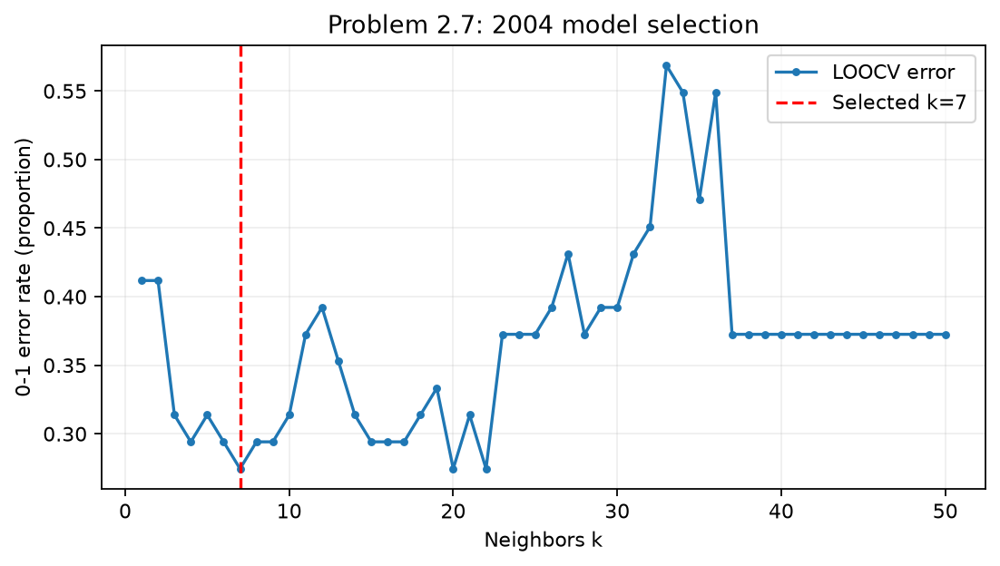
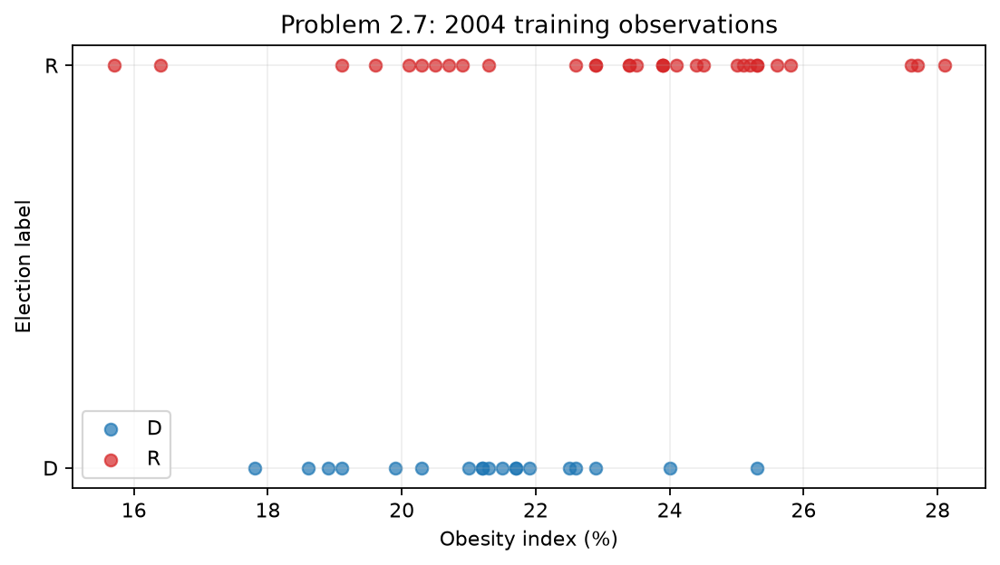
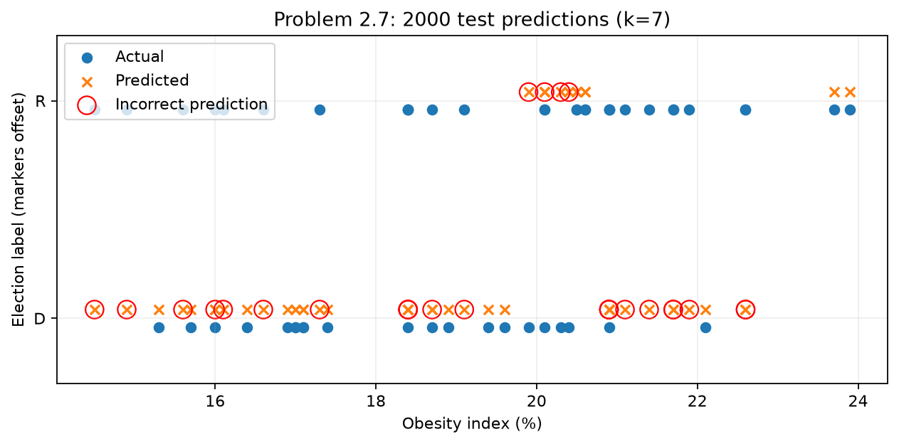
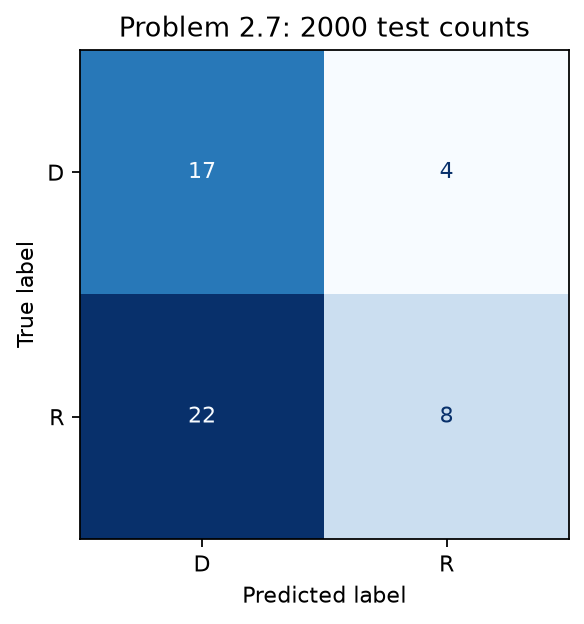

[LOO scores](results/tables/problem_2_7_loocv.csv), [every LOO prediction](results/tables/problem_2_7_loocv_predictions.csv), [training predictions](results/tables/problem_2_7_training_predictions.csv), [test predictions](results/tables/problem_2_7_test_predictions.csv), [misclassified states](results/tables/problem_2_7_misclassified_states.csv), [confusion counts](results/tables/problem_2_7_confusion_matrix.csv).

### Discussion / limitations

Test minus LOO error is 0.23529412, or 23.5294 percentage points. The selected k is supported by its LOO minimum in the specified search, not by a guarantee of optimal population risk. Small k gives more flexible local decisions but increases sensitivity to noise and ties; large k smooths decisions and can underfit. The minimized LOO score can be optimistic after selection over 50 candidates.

The test mistakes and overlapping classes show that obesity does not uniquely determine the supplied outcomes. Year-to-year shifts in obesity and labels can change the joint distribution. Geographic dependence and the reuse of the same states challenge i.i.d. and stationarity assumptions. Statistical dependency is not evidence that obesity causes voting outcomes (Lecture Set 2, p. 13).

## Problem 2.8: KNN classification

### Problem description and dataset / experimental setup

Predict R/D from obesity alone. Use 51 observations from 2000 for training and 51 from 2004 for external testing. Test features and labels never select k. This is cross-year transfer on the same states, rather than an independent sample of new states.

### Mathematical formulation and model selection procedure

Euclidean distance for the single feature is |x-x_i|. The nearest k observations vote uniformly. The 0-1 loss is 1 for an incorrect label and 0 otherwise; error rate averages this loss. For every k=1,...,50, 51 LOO fits each use 50 observations and predict exactly one held-out observation. Choose the smallest k attaining the minimum LOO error, then fit again on all training observations. Both even and odd k are included.

scikit-learn uses the explicit brute-force Euclidean backend, original CSV order, and one numerical thread. A class-vote tie selects D (first sorted class). Equal distances at the kth neighbor can cause membership to depend on row order and library implementation; fixed order and package versions are part of reproduction. No extra feature or artificial jitter is used.

### Experimental results

Optimal k = **7**, with tied best values 7, 9, 16, 24, 25, 26, 27, 28. Resampling / LOOCV error = **0.37254902 (37.25%)**. Training error = **0.27450980 (27.45%)**. Test error = **0.43137255 (43.14%)**, or **22/51** incorrect labels. Test accuracy = **0.56862745 (56.86%)**.

Confusion matrix entries are counts; rows are actual D/R and columns are predicted D/R.

| Actual | Predicted D | Predicted R |
| --- | --- | --- |
| D | 2 | 17 |
| R | 5 | 27 |

Misclassified test states:

| State | Obesity | Election_Result | Predicted |
| --- | --- | --- | --- |
| California | 21.5 | D | R |
| Colorado | 16.4 | R | D |
| Connecticut | 18.9 | D | R |
| Delaware | 22.5 | D | R |
| DC | 21.2 | D | R |
| Hawaii | 15.7 | R | D |
| Illinois | 22.9 | D | R |
| Maine | 21.3 | D | R |
| Maryland | 21.7 | D | R |
| Massachusetts | 17.8 | D | R |
| Michigan | 25.3 | D | R |
| Minnesota | 22.6 | D | R |
| Montana | 19.1 | R | D |
| New Jersey | 20.3 | D | R |
| New York | 21.2 | D | R |
| Oregon | 21 | D | R |
| Pennsylvania | 24 | D | R |
| Rhode Island | 18.6 | D | R |
| Utah | 19.6 | R | D |
| Washington | 21.7 | D | R |
| Wisconsin | 21.9 | D | R |
| Wyoming | 20.1 | R | D |

### Figures and tables

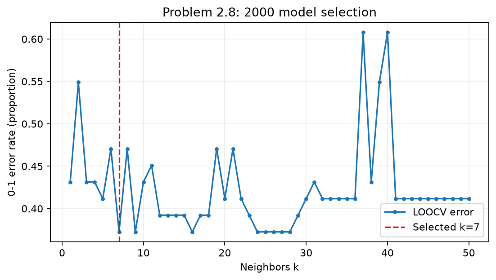
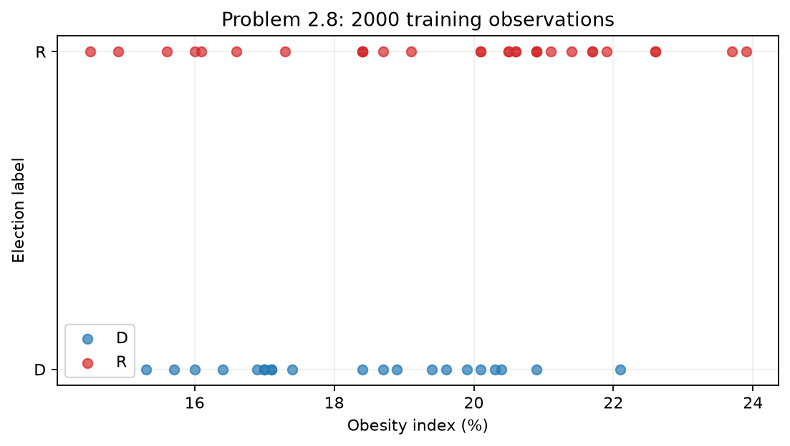
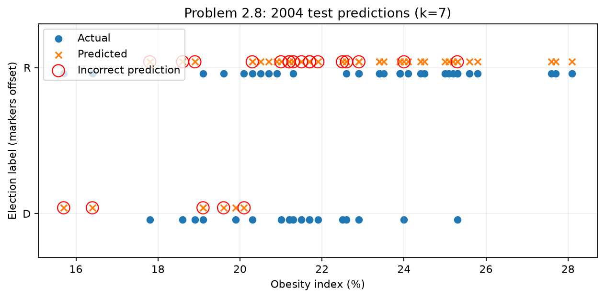
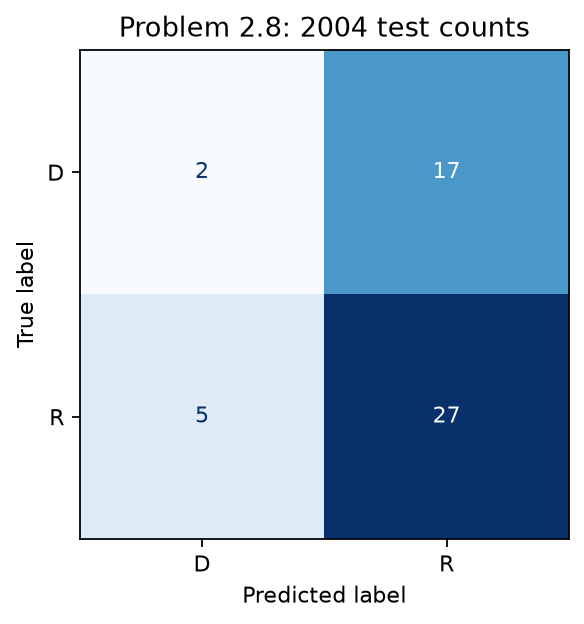

[LOO scores](results/tables/problem_2_8_loocv.csv), [every LOO prediction](results/tables/problem_2_8_loocv_predictions.csv), [training predictions](results/tables/problem_2_8_training_predictions.csv), [test predictions](results/tables/problem_2_8_test_predictions.csv), [misclassified states](results/tables/problem_2_8_misclassified_states.csv), [confusion counts](results/tables/problem_2_8_confusion_matrix.csv).

### Discussion / limitations

Test minus LOO error is 0.05882353, or 5.8824 percentage points. The selected k is supported by its LOO minimum in the specified search, not by a guarantee of optimal population risk. Small k gives more flexible local decisions but increases sensitivity to noise and ties; large k smooths decisions and can underfit. The minimized LOO score can be optimistic after selection over 50 candidates.

The test mistakes and overlapping classes show that obesity does not uniquely determine the supplied outcomes. Year-to-year shifts in obesity and labels can change the joint distribution. Geographic dependence and the reuse of the same states challenge i.i.d. and stationarity assumptions. Statistical dependency is not evidence that obesity causes voting outcomes (Lecture Set 2, p. 13).

## Cross-year comparison

| problem | training_year | test_year | optimal_k | loocv_error | training_error | test_error | test_accuracy | test_wrong_count | tied_best_ks |
| --- | --- | --- | --- | --- | --- | --- | --- | --- | --- |
| 2.7 | 2004 | 2000 | 7 | 0.2745098 | 0.23529412 | 0.50980392 | 0.49019608 | 26 | 7, 20, 22 |
| 2.8 | 2000 | 2004 | 7 | 0.37254902 | 0.2745098 | 0.43137255 | 0.56862745 | 22 | 7, 9, 16, 24, 25, 26, 27, 28 |

Mean obesity is 19.103922% in 2000 and 22.394118% in 2004. Swapping years changes neighborhoods, label proportions, the LOO score landscape and the relationship between test values and the training range. Therefore Problem 2.8 reselects k independently. These are possible explanations of asymmetric transfer, not causal claims. [Comparison CSV](results/tables/knn_comparison.csv).

## Problem 2.11: polynomial regression with Schwartz selection

### Problem description and dataset / experimental setup

Use the same ten observations for both families. `np.random.default_rng(42)` first draws ten x values from Uniform(0,1), then ten independent noise values from Normal(0,0.5 standard deviation). Set y=x^2+0.1x+noise. Noise variance is 0.25. The [generated sample](data/generated_example_2_6.csv) discloses x, y, sample ID, noise and the reference function. Only x and y enter estimation and selection; reference values only support generation, visualization and interpretation.

### Mathematical formulation

Trigonometric: $f_m(x)=w_0+\sum_{i=1}^m w_i\cos(2\pi i x)$, with no sine terms. Algebraic: $f_m(x)=\sum_{i=0}^m w_i x^i$. Both have DoF=m+1. SVD-based `numpy.linalg.lstsq` minimizes squared training residuals without ridge/lasso or inversion of normal equations.

### Model selection procedure

For a training size n, evaluate m=0,...,n-2 to ensure DoF<n. Thus the full n=10 sample allows m=0,...,8, including the constant-only candidate. Compute $R_{emp}=n^{-1}\sum_i(y_i-f_m(x_i))^2$, $p=(m+1)/n$, and the Lecture Set 3 p. 34 formula:

$$R_{SC}=\left(1+\frac{p\ln n}{1-p}\right)R_{emp}.$$

Minimize R_SC; exact score ties choose smaller m. The multiplier penalizes complexity increasingly as p approaches one. This is the multiplicative course formula rather than the common logarithmic BIC expression.

### Experimental results

| family | optimal_m | optimal_DoF | training_mse | schwartz_criterion | rank | condition_number |
| --- | --- | --- | --- | --- | --- | --- |
| trigonometric | 0 | 1 | 0.10763802 | 0.13517644 | 1 | 1 |
| algebraic | 1 | 2 | 0.080843056 | 0.12738006 | 2 | 4.7709435 |

#### Trigonometric selection

| m | DoF | n_train | p | training_mse | schwartz_criterion | rank | condition_number | ill_conditioned |
| --- | --- | --- | --- | --- | --- | --- | --- | --- |
| 0 | 1 | 10 | 0.1 | 0.10763802 | 0.13517644 | 1 | 1 | False |
| 1 | 2 | 10 | 0.2 | 0.10752123 | 0.16941542 | 2 | 1.5747302 | False |
| 2 | 3 | 10 | 0.3 | 0.080470841 | 0.15988125 | 3 | 1.6027248 | False |
| 3 | 4 | 10 | 0.4 | 0.06250308 | 0.15844885 | 4 | 1.9791289 | False |
| 4 | 5 | 10 | 0.5 | 0.06012378 | 0.1985639 | 5 | 2.9441822 | False |
| 5 | 6 | 10 | 0.6 | 0.054634471 | 0.24333525 | 6 | 7.1987759 | False |
| 6 | 7 | 10 | 0.7 | 0.054277114 | 0.34589169 | 7 | 9.1386896 | False |
| 7 | 8 | 10 | 0.8 | 0.03251888 | 0.33202883 | 8 | 9.9590823 | False |
| 8 | 9 | 10 | 0.9 | 0.032485964 | 0.70570124 | 9 | 55.624696 | False |

Selected coefficients in basis order:

| coefficient | value |
| --- | --- |
| w0 | 0.63373005 |

[Selection CSV](results/tables/problem_2_11_trigonometric_selection.csv), [coefficients](results/tables/problem_2_11_trigonometric_coefficients.csv).

#### Algebraic selection

| m | DoF | n_train | p | training_mse | schwartz_criterion | rank | condition_number | ill_conditioned |
| --- | --- | --- | --- | --- | --- | --- | --- | --- |
| 0 | 1 | 10 | 0.1 | 0.10763802 | 0.13517644 | 1 | 1 | False |
| 1 | 2 | 10 | 0.2 | 0.080843056 | 0.12738006 | 2 | 4.7709435 | False |
| 2 | 3 | 10 | 0.3 | 0.078218602 | 0.15540645 | 3 | 27.099446 | False |
| 3 | 4 | 10 | 0.4 | 0.069338738 | 0.17577763 | 4 | 171.2318 | False |
| 4 | 5 | 10 | 0.5 | 0.069241291 | 0.22867526 | 5 | 2166.6244 | False |
| 5 | 6 | 10 | 0.6 | 0.061441135 | 0.2736513 | 6 | 9402.5468 | False |
| 6 | 7 | 10 | 0.7 | 0.054016754 | 0.34423249 | 7 | 135617.37 | False |
| 7 | 8 | 10 | 0.8 | 0.032971057 | 0.33664572 | 8 | 2688696.9 | False |
| 8 | 9 | 10 | 0.9 | 0.022905747 | 0.49758763 | 9 | 61608587 | False |

Selected coefficients in basis order:

| coefficient | value |
| --- | --- |
| w0 | 0.29587373 |
| w1 | 0.56646398 |

[Selection CSV](results/tables/problem_2_11_algebraic_selection.csv), [coefficients](results/tables/problem_2_11_algebraic_coefficients.csv).

### Figures and tables

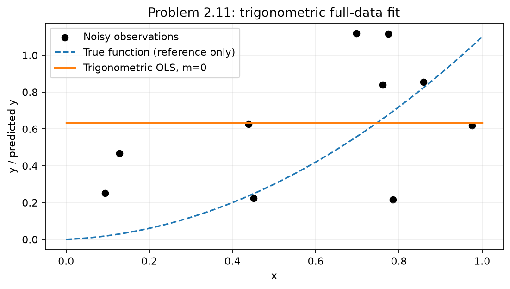
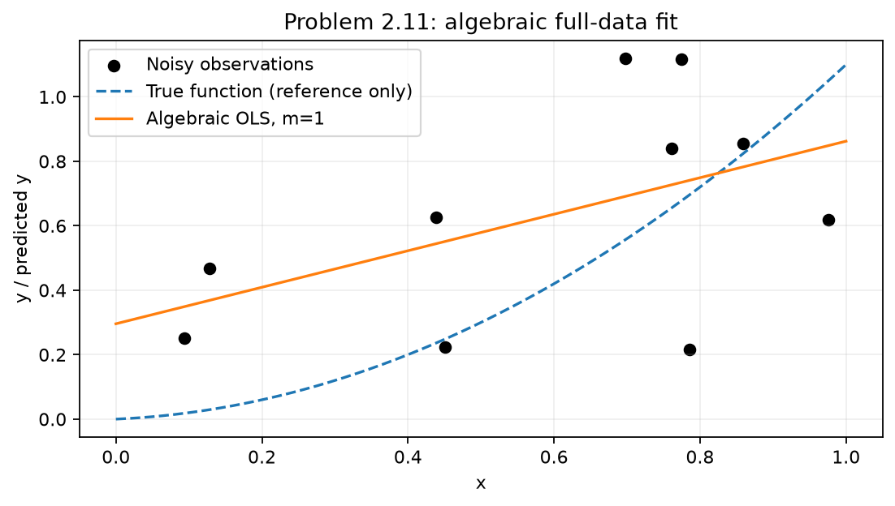
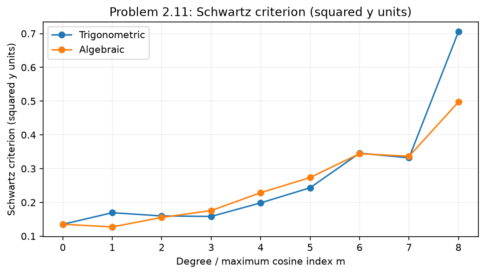
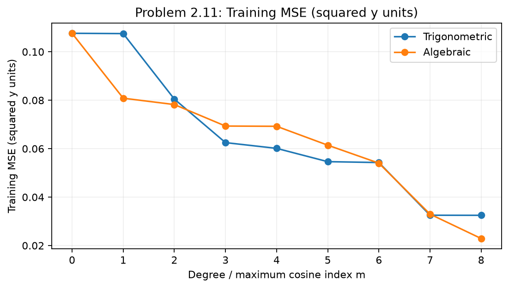

### Discussion / limitations: answer to Problem 2.11(b)

The selected **algebraic** model has the smaller full-data analytic score. That ranking alone cannot establish the best predictive family. Within a family, Schwartz selects complexity by trading training fit against parameter count. Across families, equal DoF does not imply equal approximation bias or uncertainty. The analytic score estimates rather than observes out-of-sample error. Independent assessment, as in Problem 2.12, is needed for an empirical predictive comparison and still does not prove universal superiority.

Cosine-only functions obey f(x)=f(1-x), whereas the generating function is asymmetric. This restriction helps interpret approximation bias after fitting; the reference function did not choose m. Higher degrees may reduce training loss while creating unstable predictions.

Maximum full-data candidate condition number: **61608587**. Tables record every numerical rank and condition number; >1e8 is a diagnostic flag, not an exclusion or regularizer. SVD avoids the additional instability of normal-equation inversion, but poorly conditioned bases remain sensitive. Compare rank with nominal DoF: a rank-deficient design would weaken the nominal parameter-count interpretation.

## Problem 2.12: five-fold comparison of prediction accuracy

### Problem description and dataset / experimental setup

Use the exact same ten observations as Problem 2.11. `KFold(n_splits=5, shuffle=True, random_state=42)` defines one shared partition for both families. Every fold has eight training and two held-out validation observations. Every sample is held out once per family.

### Mathematical formulation and model selection procedure

For each family and fold, minimize Schwartz using only the eight training observations over m=0,...,6. Then predict the two held-out noisy responses and compute their average squared residual (validation MSE). Full-data selected m is never reused for assessment. Schwartz is the inner selection score; validation MSE is the outer performance score (Lecture Set 3, pp. 37, 42-43, 47-48).

Mean CV MSE averages the five fold MSEs. The sample standard deviation uses ddof=1, describing fold spread rather than a confidence interval. Overall out-of-fold (OOF) MSE averages the ten held-out squared errors. Equal fold sizes imply identical mean-fold and OOF MSE, apart from rounding. Evaluation compares predictions to observed noisy y, not noiseless reference values.

### Experimental results

| fold | trigonometric_optimal_m | trigonometric_validation_mse | algebraic_optimal_m | algebraic_validation_mse |
| --- | --- | --- | --- | --- |
| 1 | 0 | 0.017932136 | 1 | 0.028596402 |
| 2 | 0 | 0.14729185 | 6 | 942.63846 |
| 3 | 5 | 0.40218333 | 3 | 0.33297101 |
| 4 | 0 | 0.24554347 | 0 | 0.24554347 |
| 5 | 0 | 0.20665914 | 0 | 0.20665914 |

| family | mean_validation_mse | std_fold_mse_ddof1 | oof_mse |
| --- | --- | --- | --- |
| trigonometric | 0.20392199 | 0.14039818 | 0.20392199 |
| algebraic | 188.69045 | 421.46977 | 188.69045 |

The **trigonometric** family has lower mean CV MSE in this experiment. Trigonometric minus algebraic mean CV MSE = **-188.48652** squared y units.

The largest algebraic error is in fold **2**, where the selected degree is **6**. Its training-only Schwartz score is **0.033845894**, but held-out MSE is **942.63846**; condition number is **530561.74**. At held-out x=0.97562235, observed y=0.61975498, predicted y=44.035383. This one unstable high-degree fit dominates the aggregate. The error is retained without clipping or adding unrequested regularization.

### Figures and tables

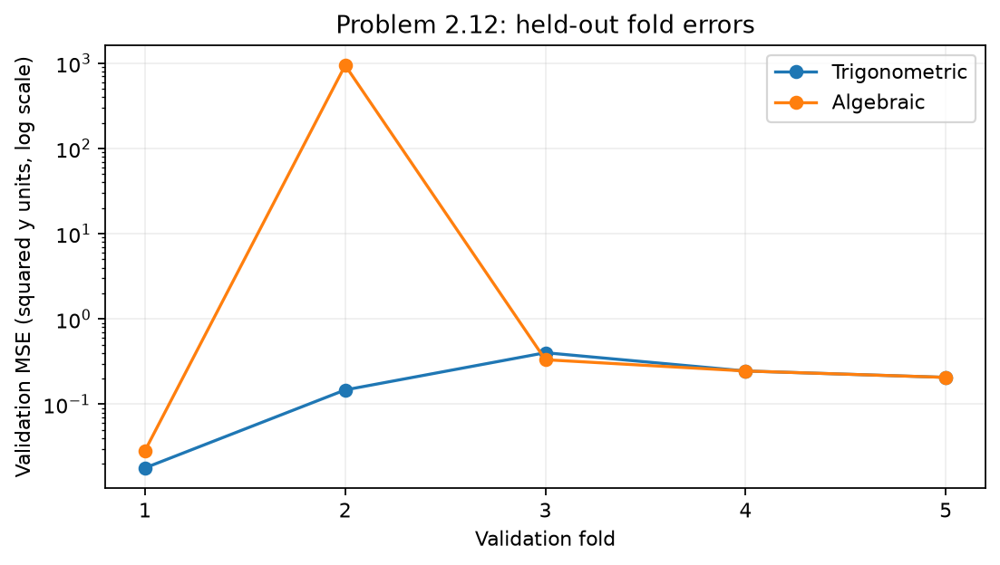
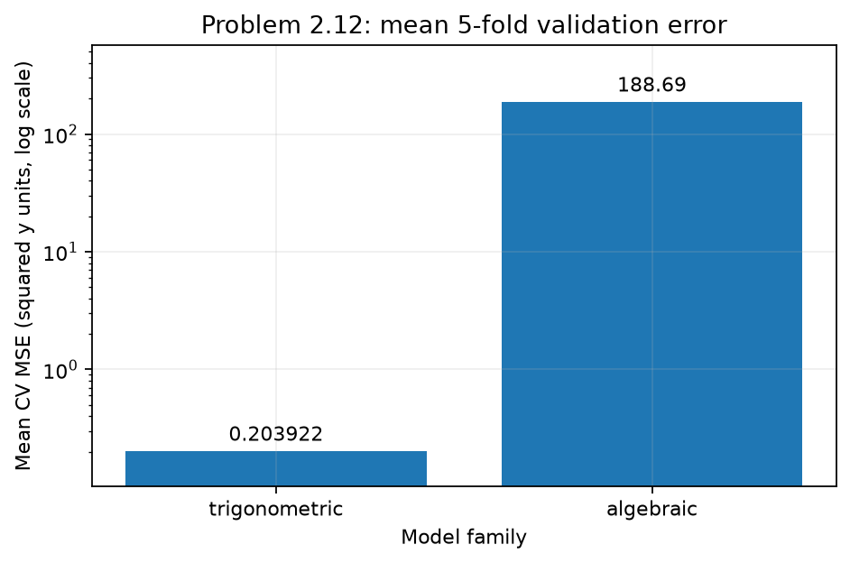
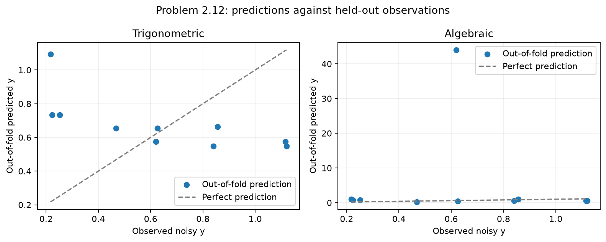

Fold and mean MSE plots use labeled logarithmic vertical axes to make both families visible. OOF plots retain the full prediction range.

[Fold results](results/tables/problem_2_12_folds.csv), [all training-fold selection scores](results/tables/problem_2_12_fold_selection.csv), [assignments](results/tables/problem_2_12_fold_assignments.csv), [OOF predictions](results/tables/problem_2_12_oof_predictions.csv), [summary](results/tables/problem_2_12_summary.csv).

### Discussion / limitations

Schwartz approximates risk from training fit and complexity; it does not observe held-out responses and cannot guarantee the smallest validation error. Complex fits amplify noise, especially with clustered training inputs or poorly conditioned monomial matrices; simple fits may underfit. This is the bias-variance trade-off (Lecture Set 3, pp. 25-32).

With just ten noisy observations, two-point fold errors vary strongly and a single unstable prediction may dominate. Fold training sets overlap, so fold errors are not independent. The comparison describes this sample, fixed partition and eight-observation fitting procedure, not all datasets or the exact population risk of the final ten-point models. Repeated assessment could explore sensitivity but is outside the requested experiment.

## Reproduction and verification

Run `python main.py` from HW1, or `python HW1/main.py` from the parent directory, after installing requirements. All samples, tables, figures and this report are regenerated. The automated tests check validation, noise construction, basis definitions, criterion bounds, LOO exclusion, tie handling, training-only fold selection, OOF coverage and artifact/report consistency. Deterministic artifact hashes are compared across repeated runs and a clean temporary project.

Runtime: Python 3.11.17, NumPy 2.4.6, pandas 3.0.6, scikit-learn 1.9.1, Matplotlib 3.11.2. CSV order and package versions are fixed for reproducibility.
